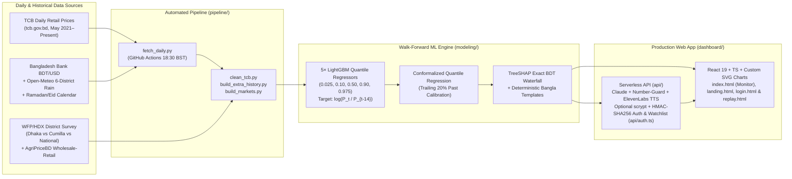

# FairPrice BD (ন্যায্য দাম)

[](https://github.com/M-U-Rony/cou_hackathon/actions/workflows/ci.yml)
[](https://github.com/M-U-Rony/cou_hackathon/actions/workflows/daily-update.yml)

**An Explainable Food-Price Anomaly Detection & Early Warning System for Bangladesh** — built for **CoU AI Hackathon (TechNova) 2026**.

> **Core Thesis:** FairPrice BD is **not** a point-price forecaster and does **not** claim to prove market syndicates. Using only information available **14 days earlier (`H = 14`)**, it computes a calibrated **80% & 95% Expected Price Band** for today and measures whether a price jump is explained by seasonality, recent momentum, exchange rates, or rainfall—or whether it is an **unexplained anomaly (`unexplained_pct`)**. Because major crises breach normal ranges before peaking, the system raises **early warnings 2 to 7 weeks before the peak**.

---

## System Architecture



---

## Verified Walk-Forward Evaluation (Jan 2023 – Nov 2026)

All metrics below are strictly out-of-sample under **monthly expanding-window walk-forward validation** (retrained every month using past data only; CQR calibrated on the trailing 20% of each past training block — **zero future data leakage**). Machine-readable summary: [`reports/evaluation_summary.json`](reports/evaluation_summary.json).

### 1. Calibration & False-Alarm Reduction (Model vs 84-Day Rolling Baseline)

| Commodity | Test Days | Model 80% Cov. | Model 95% Cov. | Model FA / 100 Normal Days | Baseline FA / 100 Normal Days | False-Alarm Reduction |
|---|---:|---:|---:|---:|---:|---:|
| **Local Onion (`onion_local`)** | 1,126 | 78.6% | 92.3% | **6.63** | 29.32 | **4.42× fewer** |
| **Farm Egg (`egg_farm`)** | 1,126 | 82.1% | 93.6% | **6.48** | 25.81 | **3.98× fewer** |
| **Green Chili (`green_chili`)** | 1,108 | 77.6% | 93.6% | **4.98** | 16.57 | **3.33× fewer** |
| **Potato (`potato`)** | 1,126 | 79.4% | 92.5% | **8.10** | 24.01 | **2.96× fewer** |
| **Import Onion (`onion_import`)**\* | 563 | 76.2% | 89.7% | **10.30** | 30.37 | **2.95× fewer** |

\* *TCB discontinued `onion_import` reporting after February 2026; historical series is preserved without interpolation.*

### 2. Equal False-Alarm Budget Comparison (`modeling/fair_compare.py`, 7 Historical Crises)

When thresholds are calibrated so both methods emit the **exact same false-alarm rate** on normal days:

| Target False Alarms / 100 Normal Days | Model Mean Lead Time (Detected) | Baseline Mean Lead Time (Detected) | Advantage |
|---:|---:|---:|---|
| **1 / 100** (High-precision alert) | **16.3 days** | 7.3 days | **2.2× earlier** |
| **2 / 100** (Operational alert) | **19.0 days** | 10.2 days | **1.9× earlier** |

### 3. Historical Crisis Replay Performance (`data/events.csv`, 7/7 Detected)

| Crisis Event | Commodity | Peak Date | Model First Flag | Lead Time to Peak |
|---|---|---|---:|---:|
| Late-2024 Potato Spike | `potato` | 2024-11-23 | 2024-10-05 | **49 days** |
| India Onion Export Ban 2023 | `onion_local` | 2023-12-09 | 2023-11-01 | **38 days** |
| Spring 2026 Egg Rise | `egg_farm` | 2026-05-15 | 2026-04-20 | **25 days** |
| July 2026 Green Chili Spike | `green_chili` | 2026-07-29 | 2026-07-13 | **16 days** |
| Oct 2024 Farm Egg Spike | `egg_farm` | 2024-10-15 | 2024-10-01 | **14 days** |
| Autumn 2026 Egg Record | `egg_farm` | 2026-10-11 | 2026-09-28 | **13 days** |
| Nov 2025 Onion Spike | `onion_local` | 2025-11-10 | 2025-11-03 | **7 days** |

---

## Key Engineering & ML Design Decisions

1. **Why `H = 14` Days (Not `H = 1`)?**
   A 1-day horizon collapses to persistence (`P_t ≈ P_{t-1}`), normalizing gradual manipulation or sustained spikes. Anchoring 14 days back exposes abnormal multi-week surges, while a `steady_rise` rule (5 consecutive days with normalized score `> 0.6`) catches slow creeps inside the band (improving 2024 potato lead time from 13 to 49 days).
2. **Ablation-Driven Feature Selection (`modeling/run_ablation.py`):**
   - **11 Core Features (all commodities):** `ret_14_28`, `ret_ref_roll28`, `ret_ref_roll84`, `vol_28`, `vol_84`, `range_28`, `yoy`, `doy_sin`, `doy_cos`, `month`, `gap_days`.
   - **Ramadan/Eid + BDT/USD (30–60d lag):** Kept **only for `egg_farm`** (improved false alarms `7.18 → 6.42` and Oct 2024 lead `11 → 14d`; degraded potato/onion).
   - **Producing-District Rainfall (Bogura, Rajshahi):** Kept **only for `potato`** (narrowed 80% band `36.4% → 34.5%` with equal lead/FA; degraded egg/onion).
3. **Exact Additive BDT Waterfall (`modeling/explain_bn.py`):**
   TreeSHAP (`pred_contrib=True`) log-return contributions from the median LightGBM model are compounded sequentially into exact Taka (BDT) steps so `Price_{t-14} + Σ(drivers) = Expected Price`, and `Actual - Expected = Unexplained BDT` reconciles to the exact Taka.
4. **Guardrailed GenAI (`dashboard/api/_shared.ts`, `summary.ts`, `tts.ts`):**
   - Server-side only (API keys never reach the browser); per-IP rate limiting (20/min summary, 10/min TTS); clients send only `{commodity, date}`—never free-form prompts.
   - **Deterministic `Number-Guard` (`allowedNumbers()`):** If Claude emits *any* number not present in the model's grounded `factSheet`, the LLM output is rejected and the app falls back to the deterministic Bangla template.
   - Graceful degradation: works 100% offline/without API keys (browser Bangla speech synthesis + deterministic templates).
5. **Regional & Wholesale-Retail Context (`pipeline/build_markets.py`):**
   - **Dhaka vs Cumilla vs National:** WFP/HDX monthly retail survey (`data/external/wfp_subset.csv`), plus approximate district price check (`LocalCheck`) via WFP district/Dhaka ratio (`p10/p50/p90`).
   - **Wholesale-to-Retail Spread:** AgriPriceBD daily Dhaka wholesale vs retail green chili ratio flagged when exceeding trailing 1-year 90th percentile.
6. **Zero-Cost Automated Daily CI/CD (`.github/workflows/daily-update.yml`):**
   Runs daily at **18:30 BST (12:30 UTC)** via GitHub Actions: scrapes `tcb.gov.bd/pages/daily-rmps`, fetches Open-Meteo rainfall & Bangladesh Bank USD rate, retrains the walk-forward model if new data arrived, exports `dashboard/public/fairprice_data.json` & `reports/evaluation_summary.json`, and commits to `main` (triggering Vercel auto-deploy).
7. **Optional Secure Accounts, Watchlist & Landing Page (`dashboard/api/auth.ts`, `login.html`, `landing.html`):**
   The public market monitor (`index.html`) stays open without a login wall; optional email/password accounts use zero-dependency `node:crypto` `scrypt` with per-user random salts (`timingSafeEqual`), HMAC-SHA256 signed `HttpOnly; SameSite=Lax` cookies, per-IP rate limiting, saved district and commodity watchlist sync (`PATCH /api/auth`), and Vitest crypto/HTTP unit tests (`dashboard/api/_auth.test.ts`), alongside a live-data editorial `landing.html`.

---

## Repository Structure

```text
cou_hackathon/
├── pipeline/                  # Data ingestion, Bengali Unicode cleaning, WFP & AgriPriceBD builders
│   ├── fetch_daily.py         # Automated daily scraper (TCB + Open-Meteo + Bangladesh Bank)
│   ├── clean_tcb.py           # Unicode normalization (য়→য়), Bengali numeral parsing, QC
│   ├── build_extra_history.py # Pre-2026 Green Chili bridge (AgriPriceBD × 1.275 aligned via WFP)
│   └── build_markets.py       # WFP regional ratios (Dhaka/Cumilla/National) & wholesale spread
├── modeling/                  # ML training, CQR calibration, ablation, TreeSHAP & export
│   ├── train_quantile.py      # Walk-forward 5-quantile LightGBM + CQR + steady_rise rule
│   ├── run_ablation.py        # Controlled feature ablation (calendar, USD/BDT, rainfall)
│   ├── fair_compare.py        # Equal false-alarm rate comparison vs 84-day rolling baseline
│   ├── explain_bn.py          # Exact BDT TreeSHAP waterfall & deterministic Bangla templates
│   ├── export_dashboard.py    # Exports fairprice_data.json + static diagnostic PNGs
│   └── build_eval_summary.py  # Exports compact committed reports/evaluation_summary.json
├── dashboard/                 # React 19 + TypeScript + Vite (zero charting/UI library bloat)
│   ├── index.html             # Production Entrypoint 1: Main Market Monitor & LocalCheck
│   ├── landing.html           # Production Entrypoint 2: Editorial Overview & Live TCB Snapshot
│   ├── login.html             # Production Entrypoint 3: Optional Email/Password Login & Signup
│   ├── replay.html            # Production Entrypoint 4: Projector-ready Historical Crisis Replay
│   ├── prototypes.html        # Archived early UI explorations (monitor.html, today.html)
│   ├── api/                   # Vercel Serverless Functions (scrypt + HMAC-SHA256 auth, Number-Guard summary, TTS, health)
│   └── src/                   # Custom SVG charts (src/lib/charts.tsx), Vitest suites (82 tests)
├── reports/
│   └── evaluation_summary.json # Committed machine-readable walk-forward evaluation metrics
├── tests/                     # Fast Python pytest suite (synthetic fixtures, runs in seconds)
└── .github/workflows/
    ├── ci.yml                 # Automated pytest + Vitest + TypeScript + Vite build checks
    └── daily-update.yml       # Scheduled 18:30 BST daily data refresh & retrain pipeline
```

---

## Quick Start & Verification

### 1. Run Python Tests & Pipeline
```bash
python -m venv .venv
.venv\Scripts\activate            # Linux/macOS: source .venv/bin/activate
pip install -r requirements-dev.txt

# Run unit tests (synthetic fixtures, completes in seconds)
python -m pytest

# Full walk-forward training & dashboard export
python modeling/train_quantile.py
python modeling/fair_compare.py
python modeling/export_dashboard.py
python modeling/build_eval_summary.py
```

### 2. Run Dashboard Tests, Typecheck & Build
```bash
cd dashboard
npm install
npm test                          # Vitest + Testing Library
npx tsc -p tsconfig.app.json --noEmit
npm run build                     # Production bundle (index.html, landing.html, login.html, replay.html)
npm run build:api                 # Compile serverless APIs to dist-api/ for self-hosted Docker
npm run dev                       # Local dev server (http://localhost:5173)
```

### 3. Run with Docker
```bash
# Build & run web dashboard + Node API server on http://localhost:3000
docker compose up --build web

# Optional: run walk-forward LightGBM + CQR ML training inside container
docker compose --profile pipeline run --rm pipeline
```

---

## Known Limitations (Honest Scope)

- **Dhaka Retail Core:** TCB daily series covers Dhaka retail markets; farm-gate prices are unavailable. Regional district checks (`LocalCheck`) use WFP monthly district/Dhaka ratios and are explicitly labeled as approximate.
- **Green Chili History:** TCB began reporting green chili in Feb 2026; pre-2026 history (Jul 2020 – Jun 2025) is bridged from AgriPriceBD (Mendeley, CC BY 4.0) scaled by `×1.275` using overlapping WFP ratios.
- **Discontinued Series & Gaps:** TCB stopped publishing `onion_import` after Feb 2026, and 2022 contains multi-month reporting gaps. Missing dates are **never interpolated**; `gap_days` is passed explicitly as a feature.
- **Not Legal Proof:** Flags indicate statistical departure from historical/seasonal behavior, not proof of cartel/syndicate activity.

---

## বাংলা সারসংক্ষেপ (FairPrice BD — ন্যায্য দাম)

**FairPrice BD** বাংলাদেশের নিত্যপ্রয়োজনীয় খাদ্যপণ্যের দামে **অব্যাখ্যাত বৃদ্ধি (Unexplained Price Anomaly)** শনাক্ত করার একটি আগাম সতর্কতা সিস্টেম।

- **মূল ধারণা:** এটি ভবিষ্যতের দাম অনুমান (forecast) করে না এবং সরাসরি সিন্ডিকেট প্রমাণ করার দাবিও করে না। বরং **১৪ দিন আগের (`H = 14`)** তথ্য ব্যবহার করে আজকের স্বাভাবিক দামের সীমা (**৮০% ও ৯৫% Expected Band**) বের করে এবং দেখায় দাম বাড়াটা মৌসুম, উৎসব, ডলার, বৃষ্টি বা আগের দামের গতির কারণে স্বাভাবিক, নাকি ব্যাখ্যার বাইরে অস্বাভাবিক।
- **ডেটা ও অটোমেশন:** TCB দৈনিক বাজারদর (মে ২০২১ – বর্তমান), বাংলাদেশ ব্যাংকের ডলার রেট, Open-Meteo ৬ জেলার বৃষ্টি, WFP জেলা জরিপ (ঢাকা বনাম কুমিল্লা বনাম সারা দেশ) এবং AgriPriceBD পাইকারি-খুচরা ডেটা। `.github/workflows/daily-update.yml` প্রতিদিন সন্ধ্যা ৬:৩০টায় অটোমেটিক নতুন ডেটা এনে মডেল রিট্রেইন ও ডেপ্লয় করে।
- **ব্যাখ্যাযোগ্যতা ও নিরাপদ AI:** TreeSHAP দিয়ে সরাসরি **টাকায় Waterfall** তৈরি হয় (`১৪ দিন আগের দাম ± উপাদানগুলো = প্রত্যাশিত দাম; + ব্যাখ্যাহীন অংশ = আসল দাম`)। ঐচ্ছিক Claude সারাংশে **Number-Guard** আছে—AI কোনো ভুয়া সংখ্যা বানালে লেখাটি বাতিল হয়ে মডেলের টেমপ্লেট দেখায়।
- **ড্যাশবোর্ডের বিস্তারিত:** [`dashboard/README.md`](dashboard/README.md) দেখুন।
